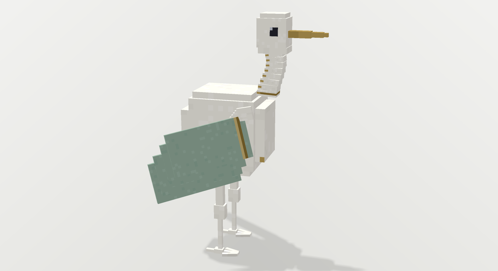
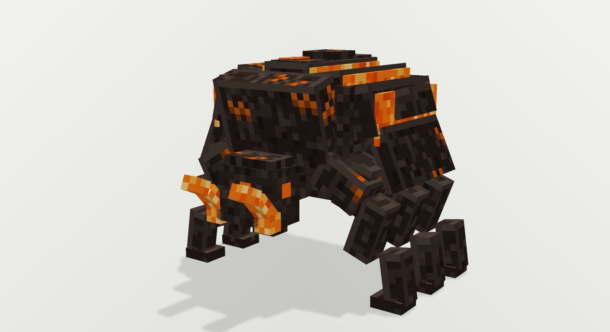
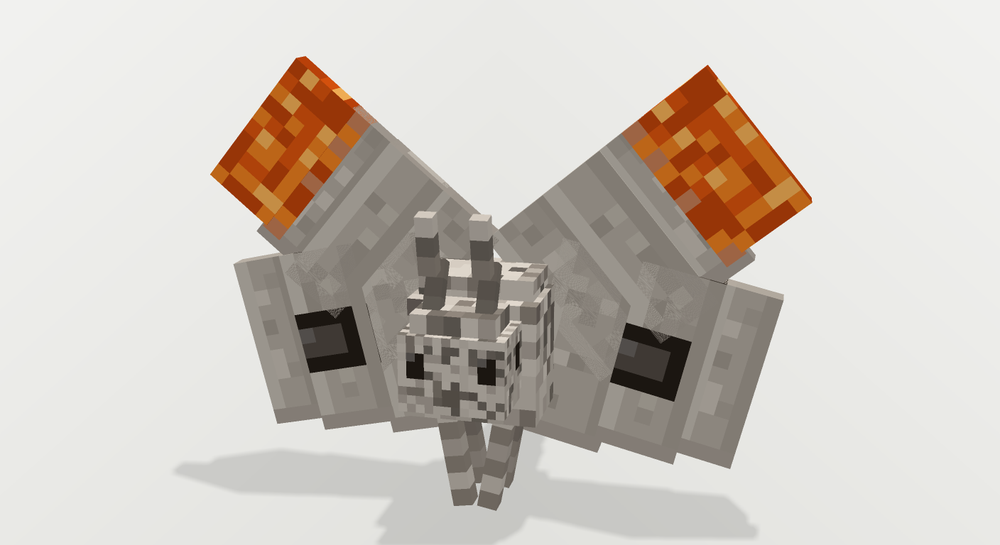

# BLENDERmodely

Блочные модели мобов для Blockbench, собранные по референс-фотографиям.
Каждая модель — нативный `.bbmodel` со вшитой текстурой-атласом 256×256,
плюс рендер для быстрой сверки с референсом.

| № | Модель | Кубы | Превью | Файлы |
|---|--------|-----:|--------|-------|
| 01 | Фарфоровый журавль | 60 | [превью](previews/01_porcelain_crane.png) | [.bbmodel](models/01_porcelain_crane.bbmodel) · [текстура](textures/01_porcelain_crane.png) |
| 02 | Базальтовый жук-углеед | 63 | [превью](previews/02_basalt_beetle.png) | [.bbmodel](models/02_basalt_beetle.bbmodel) · [текстура](textures/02_basalt_beetle.png) |
| 03 | Пепельная моль | 33 | [превью](previews/03_ash_moth.png) | [.bbmodel](models/03_ash_moth.bbmodel) · [текстура](textures/03_ash_moth.png) |

Вся галерея одной страницей: [`gallery.html`](gallery.html) — референс и рендер рядом.

---

## 01 — Фарфоровый журавль



Белая глазурованная фигурка: массивная «плита» корпуса, ступенчатая
S-образная шея из девяти убывающих сегментов с золотыми кольцами,
крупная голова с тёмным глазом и длинный трёхступенчатый золотой клюв.
Крыло — веер из трёх шалок шалфейно-зелёного фарфора с золотой кромкой
по переднему краю и ступенчатым «перьям» по заднему. Ноги длинные,
с коленным узлом и растопыренными пальцами.

- габариты: 33.1 × 46.8 × 13.2 юнита, стопы на `y = 0`
- палитра: фарфор `#efece4` / `#faf8f3` / `#dedad1`, зелень `#93b3a0`,
  золото `#b79a55` / `#d6bd7c` / `#8d7233`, глаз `#232430`
- группы с пивотами: `neck`, `head`, `wings`, `wing_l/r`

## 02 — Базальтовый жук-углеед



Панцирь из семнадцати продольных базальтовых пластин, приподнятых над
тёмным корпусом; между пластинами — тонкие швы раскалённой лавы, по
вершине панциря расходятся три трещины, на пластинах — волосяные
углевые прожилки. По бокам — светящиеся борозды, спереди — череп
с наличником и пара угловатых клешней с оранжевыми кончиками.
Шесть ног из сегментированных базальтовых столбиков.

- габариты: 38.8 × 33.8 × 40 юнитов, лапы на `y = 0`
- палитра: базальт `#2a211d` с крапом `#332a25`…`#1a1310`,
  лава `#ff7a12` / `#a83406`, блик кромки `#6b5c53`
- 63 куба, 8 лавовых швов, 3 трещины, 12 ножных сегментов

## 03 — Пепельная моль



Расправленные крылья-карты: передние уходят вверх-наружу и заканчиваются
тлеющими оранжевыми кончиками, задние — вниз-наружу, с тёмным глазком
на каждой. Тело мохнатое, пепельное, с воротником, членистым брюшком,
крупными тёмными глазами на «лице» и парой тонких переломленных усиков.

- габариты: 22 × 18.8 × 39.2 юнита, лапки на `y = 0`
- палитра: пепел `#b6aea4` / `#cdc6bc` / `#8e857b`,
  тлеющее `#e2560e` / `#ff9c2a`, тёмное `#241d17`
- группы: `body`, `head`, `wings`, `fore_l/r`, `hind_l/r`

---

## Как открыть в Blockbench

1. Скачайте нужный `.bbmodel` из папки [`models/`](models/).
2. Blockbench → **File → Open Model** → выберите файл.
3. Текстура уже вшита в файл (base64 PNG в `textures[0].source`), ничего
   подключать не нужно. Отдельный PNG в [`textures/`](textures/) — если
   захотите править рисунок снаружи.
4. Формат — **Free** (`meta.model_format = "free"`), поэтому модель
   редактируется как обычная блочная, без ограничений Bedrock/Java.

## Технические соглашения

- `meta.format_version 4.9`, `box_uv: false` — UV задаётся на каждую грань
  отдельно (`faces.<name>.uv = [u1, v1, u2, v2]`).
- Атлас 256×256, между развёртками — 1 px гаттеры и «bleed» цвета, чтобы
  не было швов при мип-маппинге.
- Точка отсчёта: `y = 0` — уровень пола, модель стоит на нём.
- Кубки-группы имеют пивоты (`origin`), так что шея, голова, крылья и
  конечности крутятся вокруг правильных осей — модель готова к анимации.

## Пайплайн

Модели собираются кодом, а не руками в редакторе — так проще держать
симметрию, точные размеры по референсу и повторяемость текстур.

```
tools/pngio.py     запись/чтение PNG без внешних зависимостей
tools/bb.py        конструктор .bbmodel: Atlas, Face-художник, Model.cube, группы
tools/mats.py      материалы-художники: porcelain, gold, basalt, ember, ash, wing_green
tools/render.py    свой растеризатор (z-буфер, гауссово сглаживание, тени)
tools/compare.py   IoU силуэта и наложение на референс
tools/validate.py  проверка .bbmodel: uuid, UV в пределах атласа, текстура вшита
tools/make_previews.py  рендеры 1408×768 + превью-миниатюры + gallery.html
models/build_*.py  скрипт-сборщик каждой модели
```

Пересобрать всё:

```bash
python3 models/build_01_porcelain_crane.py
python3 models/build_02_basalt_beetle.py
python3 models/build_03_ash_moth.py
python3 tools/validate.py
python3 tools/make_previews.py
```

Требуется только `pillow` и `numpy`.

## Про процесс, честно

- В этом окружении **не оказалось Blockbench MCP** (инструмент отвечает
  `unsupported`). Поэтому модели собраны не кликами в Blockbench, а
  скриптами-генераторами `.bbmodel` — с точным соблюдением формата
  Blockbench (сверено с исходниками `JannisX11/blockbench`:
  порядок граней, развёртка `Cube.updateUV`, порядок углов Эйлера `ZYX`).
  Файлы открываются в Blockbench как обычные модели.
- Рендеры превью сделаны собственным растеризатором поверх тех же
  `.bbmodel` — это не скриншоты Blockbench, но геометрия и UV те же.
- Референсы лежат в [`references/`](references/).

## Дальше

Готовы 01–03. Следующие из списка референсов — 04…15 (прочие существа
набора), в том же порядке: геометрия → UV/текстура → рендер-сверка.
